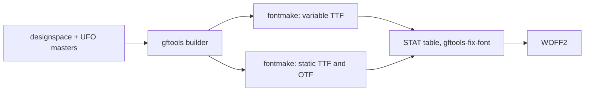

# Architecture

Offentlig is one repository and one SemVer version for the whole superfamily. Families share one tree and are told apart by file name in `sources/` and by subfolder in the build output.

## Layout

```text
sources/
  OffentligSans.designspace, OffentligSans-Italic.designspace
  OffentligSans-{Thin,Regular,Black}.ufo, OffentligSans-{ThinItalic,RegularItalic,BlackItalic}.ufo
  config-OffentligSans.yaml        gftools builder configuration
tests/                             pytest suite, runs against the built fonts
scripts/verify_commit.sh           pre-commit verification
scripts/check_prose.sh             house style check (Vale), run by verify_commit.sh and prose.yaml
scripts/check_conflict_markers.sh  fails on leftover git conflict markers, run by verify_commit.sh and prose.yaml
scripts/release_notes.sh           CHANGELOG.md section for one version, used as the release notes
.github/workflows/ci.yaml          CI: build, test, Fontspector; draft release with zip on v* tags
.github/workflows/prose.yaml       CI: conflict markers and house style check on changes to prose files
docs/                              contributor docs and docs/adr/
fonts/OffentligSans/{otf,ttf,variable,webfonts}/    build output, gitignored
```

Later families add `OffentligSerif*` and `OffentligMono*` files next to these and `fonts/OffentligSerif/` and `fonts/OffentligMono/` in the output.

## Build pipeline



- Each style (upright, italic) has three masters on the `wght` axis: Thin (design 100), Regular (design 375) and Black (design 900). The axis map sends user weights 100 – 900 to design coordinates 100, 220, 300, 375, 450, 525, 650, 775 and 900.
- The variable default is Regular (400). Static instances are declared in each designspace.
- The `STAT` table comes from `config-OffentligSans.yaml`. Regular links to Bold.
- Font version follows the package version: `0.X.Y` becomes `0.(X × 100 + Y)`, so `0.1.0` is `0.100` (`head.fontRevision`, name ID 5).

## Shared vertical metrics

These values are identical in every master and are enforced by `tests/test_metrics_and_names.py`. They stay as in Public Sans and become the shared values for later families.

| Key | Value |
| --- | --- |
| `unitsPerEm` | 2000 |
| `typoAscender` | 1900 |
| `typoDescender` | -450 |
| `typoLineGap` | 0 |
| `hheaAscender` | 1900 |
| `hheaDescender` | -450 |
| `hheaLineGap` | 0 |
| `winAscent` | 2315 |
| `winDescent` | 495 |

`USE_TYPO_METRICS` is set in every font.

## OpenType features

| Tag | Effect |
| --- | --- |
| `ss01` | Alternate `g` (`g.ss01`) |
| `ss02` | Alternate `l` (`l.ss02`) |
| `salt` | Both alternates and nothing else, as in Public Sans. Apps that offer one alternates button use `salt`, so it keeps doing what it did there; later alternates are reached only by their own tags. |
| `cv01` | Wider `J` (`J.cv01`, `Jcircumflex.cv01`) and the IJ forms that use it |
| `cv03` | Round `G` without spur, with its accented forms |
| `cv04` | Single-storey `a`, with its accented forms |
| `cv05` | `I` with serifs, with its accented forms and the IJ forms that use it |
| `ss03` | Round dots in place of the square ones: `i`, `j`, the dot accents and diaeresis with every letter built on them, `. : ; ! ? ¡ ¿ ÷ …` and the comma heads (180 `.ss03` glyphs). It runs after the `cv` features, so a dotted letter alternate has its own round-dot form (`adieresis.cv04.ss03`) and `ss03` keeps the alternate |
| `cv06` | `1` with a base (`one.cv06`, `one.cv06.osf`); the tabular `1` already has its own base |
| `zero` | Slashed `0` (`zero.slash`, `zero.slash.tf`, `zero.slash.osf`) |
| `onum` | Oldstyle figures: `0 1 2` at x-height, `3 4 5 7 9` hanging below the baseline, `6 8` at full height (`zero.osf` to `nine.osf`) |
| `aalt` | Collects every single-substitution feature in the font (`locl`, `subs`, `sinf`, `sups`, `numr`, `dnom`, `frac`, `ordn`, `lnum`, `pnum`, `tnum`, `onum`, `salt`, `ss01`, `ss02`, `ss03`, `cv01`, `cv03`, `cv04`, `cv05`, `cv06`, `zero`) |

## Invariants enforced by tests

- Italic and upright `å` differ from `ǻ`.
- U+2080 – U+2089 map to the `.subs` glyphs.
- U+207A – U+207E and U+208A – U+208E (superscript and subscript `+ − = ( )`) map to `plussuperior` and the other `*superior` glyphs and to `plus.subs` and the other `.subs` glyphs, which are the base sign scaled 0.629 and raised like the figures; `sups`, `subs` and `sinf` substitute them.
- A spaced en dash keeps both spaces at every weight.
- The em dash has the en dash's side bearings, no `calt` feature exists, and an em dash between two spaces shapes the same whether or not the text is split into runs after the dash.
- `A` is kerned against the stem-letter group (`m n r p h b`, accented n and r letters included) at every weight, in upright and italic, and never tighter than against `o` (`-20`, `-26`, `-38` in Thin, Regular, Black).
- The `name` table uses Offentlig Sans as the family and never Public Sans.
- Å Ä Ö å ä ö É é exist in every font.
- The variable default is 400, and the default named instance has the same PostScript name as the font itself.
- `Ǔ` (U+01D3) exists, so every cased letter has its counterpart (Fontspector `case_mapping`).
- The ring stroke is at least 45 % of the `o` stroke and the outer ring stays round (width to height 0.93 – 1.03) at every weight, and the ring of `ǻ` and `Ǻ` follows the plain ring's stroke share.
- The two dots of the diaeresis sit as far apart in the italic as in the upright, at every weight.
- The italic masters are sheared about half the x-height. Brought back along the 8 degree slant (`x - (y - xHeight / 2) * tan 8`), an italic glyph has the left and right bearing of its upright glyph: within 5 units for `I.cv05`, `one.cv06`, `one.cv06.osf`, `ʒ`, `ǯ`, `ẞ` and the modifier letters `ʹ ʺ ˈ ˌ ʾ ʿ`, and the ink of the combining marks below (U+0323, U+0331, U+032E) is centred on the slant line through `_bottom`. The italic superior and subscript `9` have the width of `nine.numr` and `nine.dnom` (`tests/test_italic_placement.py`, `tests/test_wagner_italic_marks.py`).
- `™` (U+2122) and `℠` (U+2120) top out at cap height, within 20 units.
- U+20BF (Bitcoin sign) is mapped in every font and has a 1400-wide tabular form under `tnum`.
- The 20 pinyin letters of uswds/public-sans#258 (Ǎ Ǐ Ǒ Ǔ Ǖ Ǘ Ǚ Ǜ Ḿ Ǹ and lowercase) are mapped, keep the width of their base letter and rise above it; the tone mark of a stacked letter clears the diaeresis.
- `M` and `m` take combining marks: base plus mark shapes to the same ink extents as the precomposed Ḿ ḿ Ǹ ǹ Ǎ Ǐ Ǒ ǎ ǐ ǒ.
- The DIN 91379 letters that are composites of existing parts (IJ ij ʼn and the Latin Extended-A/B and Extended Additional letters listed in uswds/public-sans#277) are mapped and keep the advance of their base letter. U+0310, U+0315, U+0325, U+032E and U+0331 exist as zero-width marks.
- Combining marks attach through GPOS on every base the DIN 91379 sequence list needs (F f K k M m P p T t d and the others in `tests/test_din91379.py`), and a second mark on an accented letter clears the first (mark-to-mark stacking).
- The letters drawn for DIN 91379 (Ƈ ƈ Ɨ ɨ Ǥ ǥ Ʒ ʒ Ǯ ǯ, the modifier letters ʹ ʺ ʾ ʿ ˈ ˌ, and U+030D, U+035F) are mapped in every font. The barred and hooked letters keep the advance of their base letter (ǥ is built on the single-storey `g.ss01`), Ʒ has a flat top at cap height, ʒ descends below the baseline, and U+035F is a fixed-length bar that reaches into the following letter.
- `ss01` swaps `g` only, `ss02` swaps `l` only, `salt` swaps both.
- In the italic masters every accent composite places its mark's `_name` anchor within 10 units of the base's `name` anchor.
- `cv01` (wider `J`), `cv03` (round `G`), `cv04` (single-storey `a`) and `cv05` (`I` with serifs) each swap their letter and its accented forms only. Every encoded letter built on `G`, `a` or `I` has its alternate, with its marks placed on the alternate base's anchors (`tests/test_alternate_coverage.py`). No feature changes default shaping, and `salt` stays `g` and `l`.
- `cv03` is deliberately not a mirror of the bowl: the outer lower right is about 7% fuller than the lower left in the diagonal part, in every master, to make up for the stem the default `G` has and to keep the letter from looking as if it leans forward. Do not "correct" it to a mirror. The `cv04` step is the step of `q`, which has the same flat top at x-height.
- `zero` (slashed `0`) and `cv06` (`1` with base) are opt-in. The default digits never change, and each alternate has matching tabular and oldstyle forms, except the `1`, whose tabular form already has its own base. The small digits (numerators, subscripts) keep the default design.
- The 16 `.cv05` letters (`I.cv05` and its accented forms) have their own kerning groups `public.kern1.Icv05` and `public.kern2.Icv05`, because the serifs reach into the side bearings. Each pair carries the plain `I` value plus the extra space that keeps the serifed pair within 20 units of the plain pair's closest ink distance; `tests/test_letter_alternates.py` fails if any pair with a letter touches or comes closer than 30 units.
- U+1E9E is mapped and wider than `S`; U+00DF still maps to `germandbls`.
- The ten `.tf` digits share one advance at every weight, static and variable (`tnum`).
- Black and Black Italic `five` have no tiny smooth curve at the join between the diagonal and the bowl.
- The eight arrows U+2190 – U+2193 and U+2196 – U+2199 (from public-sans pull request #252) are mapped in every font, have an advance of 1446 and outlines. Their bounding-box centre lies within 12 units of the `plus` centre for the four axis arrows and within 70 units for the four diagonals.
- `leftArrow` and `rightArrow` have the same bounding-box height.
- `onum` draws `0 1 2` at x-height, `3 4 5 7 9` hanging from x-height below the baseline, and `6 8` at full figure height, each with its own outline.
- Every glyph that carries a dot has an `.ss03` form in every font, and every dotted `.cv03`, `.cv04` or `.cv05` letter has a `.cvNN.ss03` form; `ss03` substitutes all of them (composites use the `.ss03` forms of their parts), shaping with `ss03` off contains no `.ss03` glyph, and `ss03` keeps every advance.
- The `percent` and `perthousand` slashes are at least 0.80 of the stroke of the small circles in `%`, and the `asciitilde` and `approxequal` strokes are at least 0.85 of the hyphen thickness, at every weight in both styles.
- In the italic styles a superior figure sits at its numerator figure shifted right by its rise times tan 8 degrees; in the upright styles it is not shifted. A subscript figure sits at its denominator figure shifted by its drop times tan 8 degrees (to the left) in the italic styles, within 2 units.

## Marks and anchors

- A base glyph attaches marks only if `public.openTypeCategories` in `lib.plist` lists it as `base`; anchors on an unlisted glyph are ignored by the mark feature writer.
- Bases carry `top`, `bottom`, `ogonek` and `horn` anchors; combining marks carry the matching `_top`, `_bottom`, `_ogonek` and `_horn`.
- Top marks also carry a `top` anchor above their own ink, which produces the mark-to-mark lookup. A precomposed letter with a top mark carries a `top` anchor above that mark, so a further mark stacks instead of colliding.
- Precomposed letters are component glyphs: the base letter plus mark glyphs offset to the base's anchors, with an upper mark stacked above the lower one. They join every kerning group of their base letter in `groups.plist`.
- The stored `top` and `bottom` anchor of a base-plus-mark composite is the anchor ufo2ft's propagation gives: the anchor of the last mark above (or below) the base, moved by the mark's offset. It must be stored, because a typed mark attaches to it, and an alternate built on `.cv03`, `.cv04` or `.cv05` otherwise keeps the base letter's height. `tests/test_anchor_drift.py` fails if a stored anchor is more than 1 unit from the propagated one (ligatures, glyphs mixing contours and components, and mark-first composites such as the o-horn and u-horn letters are not checked), and checks that each mark of a `.ss03` glyph is on its anchor or at the offset the plain glyph has it.
- A letter alternate keeps the width rule of its plain glyph: `width(X.cvNN) = width(X) + width(base.cvNN) - width(base)` (base is `G`, `a`, `I` or `J`), and an `.ss03` form has the width of its non-`.ss03` glyph, so the deliberately wider italic accented `a` stays wider and an alternate never runs into the next letter (checked within 0.5 units by `tests/test_anchor_drift.py`; the `IJ` ligatures are not checked).
- Drawn parts that overlap their base (the hooks of Ƈ and ƈ) are separate component glyphs named `_hook.*`, listed in `public.skipExportGlyphs`. Tangent-continuous joins in drawn contours carry `smooth="yes"`; without it the `eraseOpenCorners` filter can remove a point in one master only and break compatibility.

## Round dot construction (`ss03`)

- Each round dot is a circle with a diameter of 1.12 times the smaller side of the square dot it replaces, centred on that dot in every master. Italic circles are not sheared.
- Dots over a letter keep the lower edge of the square dot, so the clearance to the letter is unchanged; the dot below a letter keeps its upper edge.
- The two dots of `dieresiscomb.ss03` sit closer together as the weight rises: the gap between them is 0.9 times the dot diameter at Regular and 0.4 times in Black. Thin keeps the spacing of the square dots.
- The diaeresis is lowered at Thin (54 units) and Regular (34 units, the dots also grow); Black is unchanged. `dieresiscomb.ss03` follows: its dots keep the lower edge of the square dots, and at Regular the round dots keep their diameter of 200.2, which now equals the height of the enlarged square dots (1.12 times would make `ïï` overlap). The `top` anchor of both marks and the upper mark of the precomposed stacks (ǖ ǘ ǚ ǜ ȫ Ǟ and the capitals) move with the dot tops, so the gap above the dots is unchanged; in the italic masters the dots and the anchor also shift along the 8 degree slant (checked by `tests/test_diaeresis_height.py`).
- Every `.ss03` glyph with a raised `top` anchor on its plain counterpart has the same anchor, plus the amount by which the round dots rise above the square ones (never less), so a mark stacked on a dotted letter clears the dots by at least the default gap (checked by `tests/test_round_dots.py`).
- In the italic masters every `.ss03` composite places each mark so that the mark's `_top` or `_bottom` anchor lies on the anchor of the preceding component that carries that name (checked by `tests/test_round_dots.py`).
- The combining tilde swing is at least 0.55 of its stroke at every weight, and in Black the tilde and macron strokes are at most 201 units.
- The tilde inside the stacked marks (`uni03060303`, `uni03020303`: `ẫ ẵ ễ ỗ` and capitals) has the stroke and wave of `tildecomb`.
- A hook above a breve (`Ẳ`, `ẳ`) reaches no higher than the same hook above a circumflex.

## Documents

See [docs/CONTRIBUTING.md](docs/CONTRIBUTING.md) for workflow and [docs/adr/README.md](docs/adr/README.md) for decision records.
