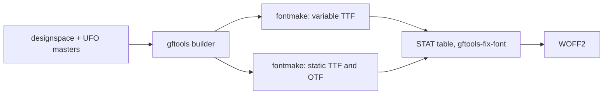

# Architecture

Offentlig is one repository and one SemVer version for the whole superfamily. Families share one tree and are told apart by file name in `sources/` and by subfolder in the build output.

## Layout

```text
sources/
  OffentligSans.designspace, OffentligSans-Italic.designspace
  OffentligSans-{Thin,Regular,Black}.ufo, OffentligSans-{ThinItalic,RegularItalic,BlackItalic}.ufo
  config-OffentligSans.yaml        gftools builder configuration
tests/                             pytest suite, runs against the built fonts
scripts/verify_commit.sh           pre-commit verification
scripts/check_prose.sh             house style check (Vale), run by verify_commit.sh and prose.yaml
scripts/check_conflict_markers.sh  fails on leftover git conflict markers, run by verify_commit.sh and prose.yaml
scripts/release_notes.sh           CHANGELOG.md section for one version, used as the release notes
.github/workflows/ci.yaml          CI: build, test, Fontspector; draft release with zip on v* tags
.github/workflows/prose.yaml       CI: conflict markers and house style check on changes to prose files
docs/                              contributor docs and docs/adr/
fonts/OffentligSans/{otf,ttf,variable,webfonts}/    build output, gitignored
```

Later families add `OffentligSerif*` and `OffentligMono*` files next to these and `fonts/OffentligSerif/` and `fonts/OffentligMono/` in the output.

## Build pipeline



- Each style (upright, italic) has three masters on the `wght` axis: Thin (design 100), Regular (design 375) and Black (design 900). The axis map sends user weights 100 – 900 to design coordinates 100, 220, 300, 375, 450, 525, 650, 775 and 900.
- The variable default is Regular (400). Static instances are declared in each designspace.
- The `STAT` table comes from `config-OffentligSans.yaml`. Regular links to Bold.
- Font version follows the package version: `0.X.Y` becomes `0.(X × 100 + Y)`, so `0.1.0` is `0.100` (`head.fontRevision`, name ID 5).

## Shared vertical metrics

These values are identical in every master and are enforced by `tests/test_metrics_and_names.py`. They stay as in Public Sans and become the shared values for later families.

| Key | Value |
| --- | --- |
| `unitsPerEm` | 2000 |
| `typoAscender` | 1900 |
| `typoDescender` | -450 |
| `typoLineGap` | 0 |
| `hheaAscender` | 1900 |
| `hheaDescender` | -450 |
| `hheaLineGap` | 0 |
| `winAscent` | 2315 |
| `winDescent` | 495 |

`USE_TYPO_METRICS` is set in every font.

## OpenType features

| Tag | Effect |
| --- | --- |
| `ss01` | Alternate `g` (`g.ss01`) |
| `ss02` | Alternate `l` (`l.ss02`) |
| `salt` | Both alternates and nothing else, as in Public Sans. Apps that offer one alternates button use `salt`, so it keeps doing what it did there; later alternates are reached only by their own tags. |
| `aalt` | Collects every single-substitution feature in the font (`locl`, `subs`, `sinf`, `sups`, `numr`, `dnom`, `frac`, `ordn`, `lnum`, `pnum`, `tnum`, `onum`, `salt`, `ss01`, `ss02`) |

## Invariants enforced by tests

- Italic and upright `å` differ from `ǻ`.
- U+2080 – U+2089 map to the `.subs` glyphs.
- A spaced en dash keeps both spaces at every weight.
- The em dash has the en dash's side bearings, no `calt` feature exists, and an em dash between two spaces shapes the same whether or not the text is split into runs after the dash.
- `A` is kerned against the stem-letter group (`m n r p h b`, accented n and r letters included) at every weight, in upright and italic, and never tighter than against `o` (`-20`, `-26`, `-38` in Thin, Regular, Black).
- The `name` table uses Offentlig Sans as the family and never Public Sans.
- Å Ä Ö å ä ö É é exist in every font.
- The variable default is 400, and the default named instance has the same PostScript name as the font itself.
- `Ǔ` (U+01D3) exists, so every cased letter has its counterpart (Fontspector `case_mapping`).
- The ring stroke is at least 45 % of the `o` stroke and the outer ring stays round (width to height 0.93 – 1.03) at every weight, and the ring of `ǻ` and `Ǻ` follows the plain ring's stroke share.
- The two dots of the diaeresis sit as far apart in the italic as in the upright, at every weight.
- `™` (U+2122) and `℠` (U+2120) top out at cap height, within 20 units.
- U+20BF (Bitcoin sign) is mapped in every font and has a 1400-wide tabular form under `tnum`.
- The 20 pinyin letters of uswds/public-sans#258 (Ǎ Ǐ Ǒ Ǔ Ǖ Ǘ Ǚ Ǜ Ḿ Ǹ and lowercase) are mapped, keep the width of their base letter and rise above it; the tone mark of a stacked letter clears the diaeresis.
- `M` and `m` take combining marks: base plus mark shapes to the same ink extents as the precomposed Ḿ ḿ Ǹ ǹ Ǎ Ǐ Ǒ ǎ ǐ ǒ.
- The DIN 91379 letters that are composites of existing parts (IJ ij ʼn and the Latin Extended-A/B and Extended Additional letters listed in uswds/public-sans#277) are mapped and keep the advance of their base letter. U+0310, U+0315, U+0325, U+032E and U+0331 exist as zero-width marks.
- Combining marks attach through GPOS on every base the DIN 91379 sequence list needs (F f K k M m P p T t d and the others in `tests/test_din91379.py`), and a second mark on an accented letter clears the first (mark-to-mark stacking).
- The letters drawn for DIN 91379 (Ƈ ƈ Ɨ ɨ Ǥ ǥ Ʒ ʒ Ǯ ǯ, the modifier letters ʹ ʺ ʾ ʿ ˈ ˌ, and U+030D, U+035F) are mapped in every font. The barred and hooked letters keep the advance of their base letter (ǥ is built on the single-storey `g.ss01`), Ʒ has a flat top at cap height, ʒ descends below the baseline, and U+035F is a fixed-length bar that reaches into the following letter.
- `ss01` swaps `g` only, `ss02` swaps `l` only, `salt` swaps both.
- U+1E9E is mapped and wider than `S`; U+00DF still maps to `germandbls`.
- The ten `.tf` digits share one advance at every weight, static and variable (`tnum`).
- Black and Black Italic `five` have no tiny smooth curve at the join between the diagonal and the bowl.
- The eight arrows U+2190 – U+2193 and U+2196 – U+2199 (from public-sans pull request #252) are mapped in every font, have an advance of 1446 and outlines. Their bounding-box centre lies within 12 units of the `plus` centre for the four axis arrows and within 70 units for the four diagonals.
- `leftArrow` and `rightArrow` have the same bounding-box height.
- `onum` draws `0 1 2` at x-height, `3 4 5 7 9` hanging from x-height below the baseline, and `6 8` at full figure height, each with its own outline.

## Marks and anchors

- A base glyph attaches marks only if `public.openTypeCategories` in `lib.plist` lists it as `base`; anchors on an unlisted glyph are ignored by the mark feature writer.
- Bases carry `top`, `bottom`, `ogonek` and `horn` anchors; combining marks carry the matching `_top`, `_bottom`, `_ogonek` and `_horn`.
- Top marks also carry a `top` anchor above their own ink, which produces the mark-to-mark lookup. A precomposed letter with a top mark carries a `top` anchor above that mark, so a further mark stacks instead of colliding.
- Precomposed letters are component glyphs: the base letter plus mark glyphs offset to the base's anchors, with an upper mark stacked above the lower one. They join every kerning group of their base letter in `groups.plist`.
- Drawn parts that overlap their base (the hooks of Ƈ and ƈ) are separate component glyphs named `_hook.*`, listed in `public.skipExportGlyphs`. Tangent-continuous joins in drawn contours carry `smooth="yes"`; without it the `eraseOpenCorners` filter can remove a point in one master only and break compatibility.

## Documents

See [docs/CONTRIBUTING.md](docs/CONTRIBUTING.md) for workflow and [docs/adr/README.md](docs/adr/README.md) for decision records.
