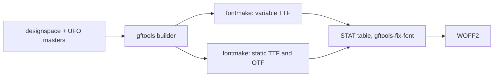

# Architecture

Offentlig is one repository and one SemVer version for the whole superfamily. Families share one tree and are told apart by file name in `sources/` and by subfolder in the build output.

## Layout

```text
sources/
  OffentligSans.designspace, OffentligSans-Italic.designspace
  OffentligSans-{Thin,Regular,Black}.ufo, OffentligSans-{ThinItalic,RegularItalic,BlackItalic}.ufo
  config-OffentligSans.yaml        gftools builder configuration
tests/                             pytest suite, runs against the built fonts
scripts/verify_commit.sh           pre-commit verification
.github/workflows/ci.yaml          CI: build, test, Fontspector; draft release with zip on v* tags
docs/                              contributor docs and docs/adr/
fonts/OffentligSans/{otf,ttf,variable,webfonts}/    build output, gitignored
```

Later families add `OffentligSerif*` and `OffentligMono*` files next to these and `fonts/OffentligSerif/` and `fonts/OffentligMono/` in the output.

## Build pipeline



- Each style (upright, italic) has three masters on the `wght` axis: Thin (design 100), Regular (design 375) and Black (design 900). The axis map sends user weights 100 – 900 to design coordinates 100, 220, 300, 375, 450, 525, 650, 775 and 900.
- The variable default is Regular (400). Static instances are declared in each designspace.
- The `STAT` table comes from `config-OffentligSans.yaml`. Regular links to Bold.
- Font version follows the package version: `0.X.Y` becomes `0.(X × 100 + Y)`, so `0.1.0` is `0.100` (`head.fontRevision`, name ID 5).

## Shared vertical metrics

These values are identical in every master and are enforced by `tests/test_metrics_and_names.py`. They stay as in Public Sans and become the shared values for later families.

| Key | Value |
| --- | --- |
| `unitsPerEm` | 2000 |
| `typoAscender` | 1900 |
| `typoDescender` | -450 |
| `typoLineGap` | 0 |
| `hheaAscender` | 1900 |
| `hheaDescender` | -450 |
| `hheaLineGap` | 0 |
| `winAscent` | 2315 |
| `winDescent` | 495 |

`USE_TYPO_METRICS` is set in every font.

## Invariants enforced by tests

- Italic and upright `å` differ from `ǻ`.
- U+2080 – U+2089 map to the `.subs` glyphs.
- U+207A – U+207E and U+208A – U+208E (superscript and subscript `+ − = ( )`) map to `plussuperior` and the other `*superior` glyphs and to `plus.subs` and the other `.subs` glyphs, which are the base sign scaled 0.629 and raised like the figures; `sups`, `subs` and `sinf` substitute them.
- A spaced en dash keeps both spaces at every weight.
- The `name` table uses Offentlig Sans as the family and never Public Sans.
- Å Ä Ö å ä ö É é exist in every font.
- The variable default is 400, and the default named instance has the same PostScript name as the font itself.
- `Ǔ` (U+01D3) exists, so every cased letter has its counterpart (Fontspector `case_mapping`).
- `ss01` swaps `g` only, `ss02` swaps `l` only, `salt` swaps both.
- In the italic styles a superior figure sits at its numerator figure shifted right by its rise times tan 8 degrees; in the upright styles it is not shifted.

## Documents

See [docs/CONTRIBUTING.md](docs/CONTRIBUTING.md) for workflow and [docs/adr/README.md](docs/adr/README.md) for decision records.
