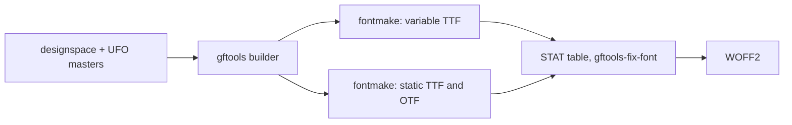

# Architecture

Offentlig is one repository and one SemVer version for the whole superfamily. Families share one tree and are told apart by file name in `sources/` and by subfolder in the build output. Units are font units of 2000 per em unless a number says otherwise.

## Layout

```text
sources/
  OffentligSans.designspace, OffentligSans-Italic.designspace
  OffentligSans-{Thin,Regular,Black}.ufo, OffentligSans-{ThinItalic,RegularItalic,BlackItalic}.ufo
  config-OffentligSans.yaml        gftools builder configuration
tests/                             pytest suite, runs against the built fonts
Makefile                           venv, build, test, qa, proof, diff-public-sans, diff-main, specimen, social-preview, install, verify, clean
requirements.txt, requirements-qa.txt   Python dependencies for the build and for QA
scripts/verify_commit.sh           pre-commit verification
scripts/check_prose.sh             house style check (Vale), run by verify_commit.sh and prose.yaml
scripts/commit-checks              loader for the shared commit-checks package: secrets, home paths, emails, private names, conflict markers, hooks (pinned in .commit-checks.json)
scripts/release_notes.sh           CHANGELOG.md section for one version, used as the release notes
scripts/proof_page.py              tester page from docs/proof/allemansratten.txt (make proof)
scripts/specimen.py                docs/specimen.png and the social preview (make specimen, make social-preview)
scripts/fsp_summary.py             summary of the Fontspector reports (make qa)
.github/workflows/ci.yaml          CI: build, test, Fontspector; draft release with zip and LICENSE on v* tags
.github/workflows/prose.yaml       CI: conflict markers and house style check on changes to prose files
docs/                              contributor docs, docs/design-decisions.md (decision register), docs/adr/, docs/proof/ (tester text) and docs/specimen.png
fonts/OffentligSans/{otf,ttf,variable,webfonts}/    build output, gitignored
build/                             Fontspector, proof and Diffenator2 output and the reference builds they compare against, gitignored
```

Later families add `OffentligSerif*` and `OffentligMono*` files next to these and `fonts/OffentligSerif/` and `fonts/OffentligMono/` in the output.

## Build pipeline



- Each style (upright, italic) has three masters on the `wght` axis: Thin (design 100), Regular (design 375) and Black (design 900). The axis map sends user weights 100 – 900 to design coordinates 100, 220, 300, 375, 450, 525, 650, 775 and 900.
- The variable default is Regular (400). Static instances are declared in each designspace.
- The `STAT` table comes from `config-OffentligSans.yaml`. Regular links to Bold.
- Font version follows the package version: `0.X.Y` becomes `0.(X × 100 + Y)`, so `0.1.0` is `0.100` and `0.2.0` is `0.200` (`head.fontRevision`, name ID 5). The sources carry it as `versionMajor` and `versionMinor` in every master's `fontinfo.plist`.

## Shared vertical metrics

These values are identical in every master and are enforced by `tests/test_metrics_and_names.py`. They stay as in Public Sans and become the shared values for later families.

| Key | Value |
| --- | --- |
| `unitsPerEm` | 2000 |
| `typoAscender` | 1900 |
| `typoDescender` | -450 |
| `typoLineGap` | 0 |
| `hheaAscender` | 1900 |
| `hheaDescender` | -450 |
| `hheaLineGap` | 0 |
| `winAscent` | 2315 |
| `winDescent` | 495 |

`USE_TYPO_METRICS` is set in every font.

## OpenType features

| Tag | Effect |
| --- | --- |
| `ss01` | Alternate `g` (`g.ss01`), also in every accented `g` (`ĝ ğ ġ ģ ǧ ǵ ḡ`), so one word never shows both forms of `g`; `ǥ` is already built on `g.ss01` |
| `ss02` | Alternate `l` (`l.ss02`), also in the `fl` ligature (`fl.ss02`), the Catalan `ŀ` (`ldot.ss02`, `ldot.ss02.ss03` under `ss03`) and every accented `l` and `ł` (`ĺ ļ ľ ł ḷ ḻ`), so one word never shows both forms of `l` |
| `salt` | Both alternates, with the `fl`, `ŀ` and accented forms of `ss01` and `ss02`, and nothing else, as in Public Sans. Apps that offer one alternates button use `salt`, so it keeps doing what it did there; later alternates are reached only by their own tags. |
| `cv01` | Wider `J` (`J.cv01`, `Jcircumflex.cv01`) and the IJ forms that use it |
| `cv03` | Round `G` without spur, with its accented forms and the barred `Ǥ` |
| `cv04` | Single-storey `a`, with its accented forms |
| `cv05` | `I` with serifs, with its accented forms, the barred `Ɨ` and the IJ forms that use it |
| `ss03` | Square dots (the dots of Public Sans) in place of the round default: `i`, `j`, the dot accents and diaeresis with every letter built on them, `. : ; ! ? ¡ ¿ ÷ …` and the comma heads, each as its own `.ss03` glyph. It runs after the `cv` features, so a dotted letter alternate has its own square-dot form (`adieresis.cv04.ss03`) and `ss03` keeps the alternate |
| `cv06` | `1` with a base (`one.cv06`, `one.cv06.osf`); the tabular `1` already has its own base |
| `zero` | Slashed `0` (`zero.slash`, `zero.slash.tf`, `zero.slash.osf`, `zero.slash.tf.osf`) |
| `onum` | Oldstyle figures: `0 1 2` at x-height, `3 4 5 7 9` hanging below the baseline, `6 8` at full height (`zero.osf` to `nine.osf`). With `tnum` also on, the same figures on the tabular advance (`zero.tf.osf` to `nine.tf.osf`) |
| `case` | Case forms for apps with an all-caps switch: the hyphen, en dash, em dash, `( ) [ ] { }`, `@` and the colon (`colon.ss03` under `ss03`) swap for their `.case` forms, which have the same advance and sit with their ink centre on the capital centre (723 at every weight) instead of at lowercase height. It runs after `ss03`, so the round-dot colon has its own raised form (`colon.ss03.case`) |
| `calt` | The same case forms, applied by context so that default text looks right next to capitals and figures; apps can turn it off. A dash, hyphen or colon is raised when both neighbours are capitals (accented capitals and their `cv` and `ss03` forms included) or lining figures (`ABC-123`, `2026-11-18`, `A–Ö`, `12:30`), not otherwise (`E-post`, `12-tal`, `KL:s`). `@` is raised before a capital. Parentheses, square brackets and braces are not in `calt`: raising each by its own neighbours left one of a pair high and the other low (`(9:00)`, `(född 1984)`), so they rise in `case` only. Marks between the characters are ignored; oldstyle figures count as lowercase and raise nothing. `calt` also swaps `T` and `Y` (and the capitals built on them) for a copy with a shorter right arm before a letter whose mark overhangs the arm (`T.arm`, `Y.arm`; see Shorter-arm capitals); the spacing of 0.5.0 then applies when it is off |
| `rclt` | Typed-accent helper capitals: a capital of the `T V W Y` kerning groups followed by one of the covered lowercase bases and a grave, macron, tilde, breve or caron is replaced by a copy that draws the same (`T.tk01`, `Y.tk03`; see Typed-accent kerning). It runs after `locl`, `ss03` and the `cv` and `ss` features, so the copy keeps their forms |
| `aalt` | Collects every single-substitution feature in the font (`locl`, `subs`, `sinf`, `sups`, `numr`, `dnom`, `frac`, `ordn`, `lnum`, `pnum`, `tnum`, `onum`, `salt`, `ss01`, `ss02`, `ss03`, `cv01`, `cv03`, `cv04`, `cv05`, `cv06`, `zero`, `case`) |

## Invariants enforced by tests

- Italic and upright `å` differ from `ǻ`.
- U+2080 – U+2089 map to the `.subs` glyphs.
- U+207A – U+207E and U+208A – U+208E (superscript and subscript `+ − = ( )`) map to `plussuperior` and the other `*superior` glyphs and to `plus.subs` and the other `.subs` glyphs, which are the base sign scaled 0.629 and raised like the figures; `sups`, `subs` and `sinf` substitute them.
- A spaced en dash keeps both spaces at every weight.
- The em dash has the en dash's side bearings, no `calt` rule changes them (`emdash.case` has the advance and ink width of `emdash`), and an em dash between two spaces shapes the same whether or not the text is split into runs after the dash.
- Every `.case` glyph (`hyphen endash emdash parenleft parenright bracketleft bracketright braceleft braceright at colon colon.ss03`) has the advance of its default form, has no code point, joins the kerning groups and glyph-to-glyph exceptions of its default form, and has its ink centre within 2 units of the centre of `H` at every static. `case` swaps all of them; `calt` swaps the hyphen, dashes, colon and `@` in the contexts of the feature table and nowhere else, and never a bracket, with `calt` on and off, with `ss03` and with `onum` (`tests/test_case_forms.py`). The pair rules hold with `case` on (`tests/test_alternate_pairs.py`).
- `A` is kerned against the stem-letter group (`m n r p h b`, accented n and r letters included) at every weight, in upright and italic, and never tighter than against `o` (`-20`, `-26`, `-38` in Thin, Regular, Black).
- The `name` table uses Offentlig Sans as the family and never Public Sans, and name ID 5 equals `Version versionMajor.versionMinor` and `head.fontRevision` equals `versionMajor.versionMinor` of the masters in every static and variable font (`tests/test_metrics_and_names.py`).
- Å Ä Ö å ä ö É é exist in every font.
- The variable default is 400, and the default named instance has the same PostScript name as the font itself.
- `Ǔ` (U+01D3) exists, so every cased letter has its counterpart (Fontspector `case_mapping`).
- The ring stroke is at least 40 % of the `o` stroke (43 % at Black for `å`, 40 % for `Å`) and the outer ring stays round (width to height 0.93 – 1.03) at every weight, and the ring of `ǻ` and `Ǻ` follows the plain ring's stroke share. The ring of `Å Ů` is the helper `_ringcap` (top 1990 at every weight; round; hole at least the stroke, 1.2 times at Black; bottom at least 50 units above the capital, 56 at Black), so `Å` clears the descenders of the line above at the default spacing at every weight (`tests/test_capital_ring.py`).
- The two dots of the diaeresis sit as far apart in the italic as in the upright, at every weight.
- The italic masters are sheared about half the x-height. Brought back along the 8 degree slant (`x - (y - xHeight / 2) * tan 8`), an italic glyph has the left and right bearing of its upright glyph: within 5 units for `I.cv05`, `one.cv06`, `one.cv06.osf`, `ʒ`, `ǯ`, `ẞ` and the modifier letters `ʹ ʺ ˈ ˌ ʾ ʿ`, the primes `′ ″ ‴` and the small letters `ʰ ʳ ˢ ᵈ ᵗ ⁿ`, and the ink of the combining marks below (U+0323, U+0331, U+032E) is centred on the slant line through `_bottom`. The italic superior and subscript `9` have the width of `nine.numr` and `nine.dnom` (`tests/test_italic_placement.py`, `tests/test_wagner_italic_marks.py`).
- `™` (U+2122) and `℠` (U+2120) top out at cap height, within 20 units.
- U+20BF (Bitcoin sign) is mapped in every font and has a 1400-wide tabular form under `tnum`.
- U+2007 (figure space), U+2008 (punctuation space), U+2009 (thin space) and U+202F (narrow no-break space) are mapped in every font with no outline; the figure space is 1400 (the tabular figure) and the thin and narrow no-break spaces 333 (a sixth of an em) at every weight, and the punctuation space is as wide as the period at each weight. They have no kerning group and no kerning pair, so they never move their neighbours.
- The 20 pinyin letters of uswds/public-sans#258 (Ǎ Ǐ Ǒ Ǔ Ǖ Ǘ Ǚ Ǜ Ḿ Ǹ and lowercase) are mapped, keep the width of their base letter and rise above it; the tone mark of a stacked letter clears the diaeresis.
- `M` and `m` take combining marks: base plus mark shapes to the same ink extents as the precomposed Ḿ ḿ Ǹ ǹ Ǎ Ǐ Ǒ ǎ ǐ ǒ.
- The DIN 91379 letters that are composites of existing parts (IJ ij ʼn and the Latin Extended-A/B and Extended Additional letters listed in uswds/public-sans#277) are mapped and keep the advance of their base letter. U+0310, U+0315, U+0325, U+032E and U+0331 exist as zero-width marks. The comma above right (U+0315) stays at least 40 units from the ink of `C c K k P p T t Č č` at every weight, upright and italic (the `_top` anchor of the mark is 65 units lower in Black, so the mark rides higher there).
- Combining marks attach through GPOS on every base the DIN 91379 sequence list needs (F f K k M m P p T t d and the others in `tests/test_din91379.py`), and a second mark on an accented letter clears the first (mark-to-mark stacking).
- The prime marks U+2032 – 2034 (`minute`, `second`, `tripleprime`) are one, two and three copies of `primemod` at the pitch of `dblprimemod`, so they match ʹ ʺ. The small letters ʰ ʳ ˢ ᵈ ᵗ ⁿ (U+02B0, U+02B3, U+02E2, U+1D48, U+1D57, U+207F) are drawn from h r s d t n, scaled to the height of `ª º` and given the stem weight of `ª` by a slightly heavier outline in each master (within 10 percent, in every weight, upright and italic). They stand on the baseline of the superior figures (the bottom of `ʳ ⁿ` and the overshoot of `ˢ ᵈ` within 20 units of `onesuperior`; 8 degrees slanted in the italic) and have 0.65 of the side bearings of h r s d t n. `ᵗ` has a left bearing of at least 50 units at Black, so `⁴ᵗ` keeps clear. `sups` maps h r s d t n to them only after a superior figure, a superior `+ − =` or parenthesis (the hyphen-minus is not a minus sign) or another small letter (a chained contextual lookup after the lookup for figures and signs), so `1er`, `Ste` and `century` keep their letters; `ordn` is unchanged (`tests/test_modifier_letters.py`).
- `V v Q q ð þ Þ ŋ ĸ Ə ƒ ẞ ɨ ị` take combining marks: each has a `top` anchor placed like its nearest sibling (`W`, `w`, `O`, `o`, `b`, `P`, `n`, `k`, `f`, `B`; `ð` sits at 1460, above its stroke), and each has a `bottom` anchor (under the descender end on `q þ ƒ ŋ`, which have a descender). `ị` and `ɨ` drop the dot under a top mark, like `i`. With U+0301, U+0300, U+0304, U+0303, U+0302, U+0306, U+0308 or U+030C, `ccmp` replaces the pair with one glyph (`idotbelow_acutecomb`, `istroke_brevecomb` and so on, `.ss03` for round dots) built on the precomposed `í ì ī ĩ î ĭ ï ǐ`, so the advance (the same in every master, `tests/test_idotless.py`), mark position and kerning match them; `ı` (and `i.loclTRK`) has the stem and advance of `i` in every master; the typed accent then clears the next letter by at least 30 units at every weight. Any other top mark swaps the letter for `idotbelow.dotless` or `istroke.dotless` (`tests/test_typed_accent_bases.py`).
- Helper capitals (`<capital>.tk01` to `.tk03`) draw exactly like their capital and have its advance, are not in the cmap and appear in no feature but the `rclt` swap. After `T V W Y` and the other capitals of their kern groups, the lowercase DIN 91379 combining sequences, Yoruba, Igbo and Lithuanian letters with a grave, macron, tilde, breve or caron clear the capital by at least 30 units (28 in the 4-unit row test) at every weight, upright and italic, with `cv04`, `ss03`, `ss01` and `ss02` on and under the Romanian `locl` (`tests/test_typed_accent_kerning.py`).
- Every Soft_Dotted letter in the cmap (`i j į ɨ ị`) drops its dot under a top mark: `ccmp` swaps `i j į` for `idotless jdotless iogonek.dotless` before a top mark (with or without a mark below between), and `ị ɨ` as above. `idotless`, `j` and `jdotless` carry a `bottom` anchor (under the stem at the baseline for `ı`, under the hook bottom at the descender for `j ȷ`), so `dotbelowcomb` and the other marks below sit on them. The Turkish round-dot `idotaccent.ss03` is drawn with the dot contour of `i.ss03`; `ċ ė ġ ż İ` keep the shared `dotaccentcomb.ss03`, which is smaller than the `i` dot in the default style too (`tests/test_feature_and_mark_fixes.py`).
- The letters drawn for DIN 91379 (Ƈ ƈ Ɨ ɨ Ǥ ǥ Ʒ ʒ, the modifier letters ʹ ʺ ʾ ʿ ˈ ˌ, and U+030D, U+035F) are mapped in every font. The barred and hooked letters keep the advance of their base letter (ǥ is built on the single-storey `g.ss01`), Ʒ has a flat top at cap height, ʒ descends below the baseline, and U+035F is a fixed-length bar that reaches into the following letter. Ǯ and ǯ are composites of Ʒ or ʒ and a caron, with the caron above the letter.
- `ss01` swaps `g` and every accented `g` (`g.ss01` with the marks of `ĝ ğ ġ ģ ǧ ǵ ḡ`). `ss02` swaps `l`, `fl`, `ŀ` (Catalan `l·l` shapes as `ldot.ss02` and `l.ss02`) and every accented `l` (`l.ss02` with the marks of `ĺ ļ ľ ḷ ḻ`, and `ł.ss02` with the bar of `ł`). `salt` swaps both letters with all those forms. The accented forms are composites on `g.ss01` and `l.ss02`, with the marks on the alternate base's anchors; `l.ss02` has a `caron` anchor beside its stem, so the wedge of `ľ` sits as far from the stem as in `l`, and `tests/test_caron_wedge.py` checks it with `ss02` on too. The italic `top` and `bottom` anchors of `l.ss02` sit on the stem (they were copied unsheared from the upright masters before). `fl.ss02` is in the kerning groups of `fl` on the left and of `l.ss02` on the right; `ldot.ss02` is in those of `l.ss02` on the left and of `ldot` on the right (`tests/test_features.py`, `tests/test_spacing.py`).
- In the italic masters every accent composite places its mark's `_name` anchor within 10 units of the base's `name` anchor.
- `cv01` (wider `J`), `cv03` (round `G`), `cv04` (single-storey `a`) and `cv05` (`I` with serifs) each swap their letter and its accented forms only. `Ǥ.cv03` is the bar of `Ǥ` on the round `G`, and `Ɨ.cv05` the bar of `Ɨ` on the serifed `I`, with a longer bar that reaches towards the serif ends; `ł.ss02` is the bar of `ł` on `l.ss02`, stem to stem. Every encoded letter built on or drawn from `G`, `I`, `g`, `l` or `a` has its alternate, with its marks placed on the alternate base's anchors (`tests/test_alternate_coverage.py`). No feature changes default shaping, and `salt` stays `g` and `l`.
- In `cv03` the outer lower right is about 8 – 9% fuller than the lower left in the diagonal part (measured from the glyph's own centre), with the Black right wall thickened to match the left wall. The `cv04` step is the step of `q`.
- `zero` (slashed `0`) and `cv06` (`1` with base) are opt-in. The default digits never change, and each alternate has matching tabular and oldstyle forms, except the `1`, whose tabular forms (`one.tf`, `one.tf.osf`) already have their own base. The small digits (numerators, subscripts) keep the default design. `tnum` and `onum` together give tabular oldstyle figures in either order: `onum` maps the `.tf` digits to `.tf.osf` (`tnum` runs first), and each `.tf.osf` glyph is the `.osf` outline placed the way the `.tf` figure sits relative to its proportional lining figure, measured along the slant, so `onum` moves no figure sideways, upright or italic. The `.tf.osf` glyphs have no kerning groups.
- The `.cv05` letters (`I.cv05`, its accented forms and `Ɨ.cv05`) have their own kerning groups `public.kern1.Icv05` and `public.kern2.Icv05`, because the serifs reach into the side bearings. Each pair carries the plain `I` value plus kerning that keeps the serifed pair within 60 units (30 per 1000 em) of the plain pair's closest ink distance, both tighter and looser; `tests/test_letter_alternates.py` fails if any letter pair touches or drifts more than 30 units per 1000 em from plain `I`.
- The accented `.ss01` and `.ss02` letters sit in the groups of `g.ss01` (`public.kern1.q`, `public.kern2.o`) and `l.ss02` (`public.kern1.u`, `public.kern2.n`), and carry glyph-to-glyph exceptions of their own where the pairs of the letter they replace need them (below). The wide macron of `ḻ.ss02` reaches past the narrower `l.ss02`, so it has its own exceptions before `) ] }`, which the tests hold to the same 30-unit floor as every accented letter, with `ss01`, `ss02` and `salt` on.
- Every encoded letter and every `cv` or `ss` form of a letter is in a `kern1` and a `kern2` group, except the letters named in `tests/test_spacing.py`. `đ` (`dcroat`) sits in `d`'s right-hand group (`public.kern1.u`). `ẞ` follows `B` on the right and `H` on the left, `IJ ij ʼn` follow the letters they are made of, the `G.cv03` forms (and `Ǥ.cv03`) have their own right-hand group `public.kern1.Gcv03` (the pairs of `G` plus the space that makes them close like `O`), and `seven.osf` has its own left-hand group `public.kern2.sevenosf`. Pair exceptions aim at a gap of 40 units (12 for `ï ḯ ị̈ ɨ̈` before `H l i b k h d` in ExtraBold and Black Italic, which the tests hold to 8; 30 everywhere else) between the marks of `ǐ ǰ ḯ ǒ ě ḻ ṟ ṯ`, the hook of `ƈ` and their neighbours; the tests fail below 30. The same holds for every accented lowercase letter after the `kern1` groups of `T`, `V` and `Y` (which hold `W` and the accented capitals): each pair is a group-to-glyph exception, and the masters are fitted so that no weight between them closes below 30. This holds with `cv04` (single-storey `a`) and `ss03` (round dots) on as well, alone or together. The tests measure the ink gap in rows 4 units tall, because 20-unit rows missed thin mark tips. Two further groups of pairs follow the same rule, with their own test: the circumflex of `î` and the breve of `ĭ` before the lowercase letters (`îl îb îh îk îi`, `ĭl ĭb ĭh ĭk ĭi`, and `ĭH`), 40-unit aim and 30 floor, with the typed `ị̆ ɨ̆` and the round-dot `i` after them, and `Ơ Ư` with their accented forms before the lowercase that follows (`Ời Ơi Ườ Ưi`); both closed in the heavy weights of Public Sans. A third group, every accented letter, lowercase and capital, with `ss03` as well, against `) ] } ? ! ' " ’ ” » ›` after it and `( [ { ¿ ¡ ' " ‘ “ « ‹` before it, uses glyph-to-glyph exceptions on the same 40-unit aim and 30-unit floor. Each master gets the smallest value that clears every static made from it: a pair that collides only from Bold up changes only the Black master, and Thin and Regular keep the spacing they had unless a static made from them collides. A test fails when Thin or Regular loosen a pair that was already clear. Changes made only in the Black masters carry into Medium to Black, so the tests check all 18 statics. The typed `ị` and `ɨ` with an acute, grave, circumflex, macron, tilde, breve, diaeresis or caron shape as one glyph (`idotbelow_acutecomb`, `istroke_brevecomb` and the others) and have the same exceptions, copied from the precomposed letter and raised where the Black masters stay under the aim; every pair with the typed glyph on the right (`Vị̈ fị̌ (ị̈ 'ị̌`) carries the exception of `ĭ ï ǐ` and kerns exactly like it, a test that compares them against every letter, digit, punctuation mark and symbol at all 18 statics, with and without `ss03` (opening punctuation excepted: its values are fitted per glyph); the same glyphs carry extra exceptions before `H l n i` so that no weight closes below 30. The pairs are in all six masters, so they interpolate. These are glyph-to-glyph exceptions for `î` and `kern1` group-to-glyph exceptions for `Ơ Ư`. `ss03` swaps in separate glyphs that share the groups of the default glyph but not its glyph-to-glyph exceptions, so every pair with a round-dot glyph on either side keeps at least the smaller of the default pair's ink gap and 30 units, less 2, at all 18 statics (`fï Ơi ïT "ï !ǐ ṯj` and the other pairs the test finds carry their own `.ss03` exceptions). `tests/test_accent_pairs.py` checks every encoded character against every character that has a round-dot form, in both orders, even where the round-dot pair's kerning equals the default pair's.
- Every pair with an accented letter keeps at least the smaller of the gap of the same pair with the unaccented base letters and 30 units, less 2. This covers every encoded accented letter (and the typed `ị` and `ɨ` with a top mark) against every encoded letter, digit, punctuation mark and symbol on both sides, so an accent on one side, an accent on both (`ĴÏ`), quotes and brackets (`"în`, `(ȁ`) and the accented forms of `a` (`cv04`) and the round-dot forms (`ss03`) are all held to it, at all 18 statics (`tests/test_accent_pairs.py`, measured with `tests/pairs.py`). Each pair that needed it is a glyph-to-glyph exception in all three masters of its style, because accented letters share the groups of their base letter and a group value would move the base letters too; it aims at 40 units and each master gets the smallest value that clears every static made from it, so Thin and Regular change only where a static made from them collides. The diaeresis pairs held to 8 are left out. The diaeresis letters `ï ī` before `ï ĩ ī` and the typed `ị̈ ɨ̈` (`ïï ïĩ ïī īï ïị̈ ïɨ̈ īị̈ īɨ̈`, also with `ss03`) carry glyph-to-glyph exceptions on the same aim in every master, because their marks meet the next letter in the italic and the tilde or macron next to them upright; the marks themselves are not redrawn. Plain pairs (no accented letter on either side) follow the same rule with a 30-unit floor: every encoded letter, digit, punctuation mark and symbol against every other, in both orders, at all 18 statics, with `ss03` and `cv04` on as well (`tests/test_plain_pairs.py`). Each pair that needed it is a glyph-to-glyph exception in all three masters of its style (a group value would move the ordinary letters of the group), aiming at 40 units with the smallest master value that clears every static made from it; the accented and round-dot forms of such a pair carry their own exceptions, because the accent test measures them against the plain pair, and the typed `ị` and `ɨ` with a mark take the value of the precomposed letter they match. Touching outlines are a separate check: rows 4 units tall cannot see two shapes that meet along a near-vertical edge or one above the other (`ḯĦ Ħḯ ǐ² ǰ²` touched in Regular), so `tests/ink.py` `outline_distance` returns 0 when outlines cross, share an edge or lie inside each other, and the tests fail for any pair of the named list, in every master and static, with a distance under 30. Pairs that touch get an exception fitted to a distance of about 40 at every weight, with a Regular value of its own, so that the Black master does not carry the whole correction. A pair whose Black or Thin gap came out above about 150 because one weight between the masters forced it is fitted the same way. Pairs the tests leave alone are named in the test with the reason given: the fraction slash (it overlaps figures, which `frac` handles); the design-decision audit in the ROADMAP reviews each of them. The doubled daggers `†† †‡ ‡† ‡‡` are kerned to 30 units in Thin, upright and italic, like every other plain pair. The named list above stays as a second, narrower check. It also measures `ŀt ŀf ŀfi ŀfl` with `ss02`+`ss03` and `salt`+`ss03`, `ḯĦ Ħḯ ïĦ Ħï īĦ Ħī` with `ss03`, and the doubled daggers, which are fitted to 30 units by outline distance in the Thin Italic as well as by row gap. The same two rules hold with the alternates on (`tests/test_alternate_pairs.py`, `tests/feature_pairs.py`): each feature alone (`ss01 ss02 ss03 cv01 cv03 cv04 cv05 cv06 zero onum`; `ss03` alone is in the accent and plain tests) and the combinations `cv04`+`ss03`, `salt`+`ss03`, `onum`+`zero`+`cv06`, every feature with `ss03`, all of them together and all but `onum` (lining figures), at all 18 statics. Only pairs with a glyph the features swap are measured, since the other pairs are the default pairs. Every alternate pair carries its own glyph-to-glyph exception where it needs one, because the alternate shares the groups of its default form but not the exceptions; a second test checks that an alternate pair is never closer than the default pair of the same characters below 30 units (less 2), over the same feature sets. `ŀ` with `ss02` has its dot moved right and its advance widened so that its right bearing equals that of `ŀ`, and `ŀl` with `ss02` is kerned to the gap of the default `ŀl`; `ỉ` has the advance of `ı`; `ǥ` is in the kerning groups of `g.ss01`, which it is built on.
- U+1E9E is mapped and wider than `S`; U+00DF still maps to `germandbls`.
- The ten `.tf` digits and the ten `.tf.osf` digits share one advance at every weight, static and variable (`tnum`, `tnum` + `onum`).
- Black and Black Italic `five` have no tiny smooth curve at the join between the diagonal and the bowl.
- Every `.arm` glyph in the font (the 18 shorter-arm capitals and their 6 `ss03` copies, found from the glyph order, so a new one is covered automatically) is not in the cmap, appears only in `calt`, has the advance and marks of its capital, is swapped in before each covered letter and kept out before the others and with `calt` off, keeps 30 units from the mark and kerns like the plain pair, in every static with the alternate forms on and off (`tests/test_arm_helpers.py`).
- The eight arrows U+2190 – U+2193 and U+2196 – U+2199 (from public-sans pull request #252) are mapped in every font, have an advance of 1446 and outlines. Their bounding-box centre lies within 12 units of the `plus` centre for the four axis arrows and within 70 units for the four diagonals.
- `leftArrow` and `rightArrow` have the same bounding-box height.
- `onum` draws `0 1 2` at x-height, `3 4 5 7 9` hanging from x-height below the baseline, and `6 8` at full figure height, each with its own outline.
- Every glyph that carries a dot has an `.ss03` form in every font, and every dotted `.cv03`, `.cv04`, `.cv05`, `.ss01` or `.ss02` letter has a `.cvNN.ss03` or `.ssNN.ss03` form; `ss03` substitutes all of them (composites use the `.ss03` forms of their parts), shaping with `ss03` off contains no `.ss03` glyph, and `ss03` keeps every advance. Round dots are sized to match the ink area of the square dot (`diameter = 2/√π × √(w × h)`), and `tests/test_diagonal_gaps.py` checks every encoded non-mark pair across all 18 statics against a 15-unit diagonal `outline_distance` floor (leaving out `⁄` and the ExtraBold/Black Italic `E2` tall-letter pairs).
- The widest circle inside `W` (centre in the lower half of the cap height) and inside `N` (either half) stays within 1.12 and 1.38 times the stem of `H` at Bold, ExtraBold and Black, upright and italic (`tests/test_join_circles.py`, G26). `W` and `N` are drawn in the Black masters and in the `won-medium` and `won-extrabold` layers of the Regular masters; every other weight interpolates them.
- The `percent` and `perthousand` slashes are at least 0.80 of the stroke of the small circles in `%`, and the `asciitilde` and `approxequal` strokes are at least 0.85 of the hyphen thickness, at every weight in both styles.
- In the italic styles a superior figure sits at its numerator figure shifted right by its rise times tan 8 degrees; in the upright styles it is not shifted. A subscript figure sits at its denominator figure shifted by its drop times tan 8 degrees (to the left) in the italic styles, within 2 units.

## Marks and anchors

- A base glyph attaches marks only if `public.openTypeCategories` in `lib.plist` lists it as `base`; anchors on an unlisted glyph are ignored by the mark feature writer.
- Bases carry `top`, `bottom`, `ogonek` and `horn` anchors; combining marks carry the matching `_top`, `_bottom`, `_ogonek` and `_horn`.
- The ogonek is one hook outline (`ogonekcomb`) that `ą Ą Ę į Į ų` and the spacing ogonek take as a component; `ę ǫ Ǫ Ų` carry their own copy of it, and `ę` is drawn into the bowl, its hook joined to the underside of the arm's end. All reach -405, -415 and -425 at Thin, Regular and Black; the hook of `ę` ends level with the arm (`tests/test_ogonek.py`). The hook tip is trimmed by up to 20 units. Kerning of `ę` before `g j ḻ ṟ ) } ƒ ⁄` and of `[ {` before `į` is set by exceptions in each master (D23); the ring of `Å Ů` is D38.
- Top marks also carry a `top` anchor above their own ink, which produces the mark-to-mark lookup. A precomposed letter with a top mark carries a `top` anchor above that mark, so a further mark stacks instead of colliding.
- `ȉ ȑ` use `dblgravecomb.narrow`, and `ccmp` swaps `dblgravecomb` for it after `ı` and `r` (`i` has already become `ı` there), so typed `i ı r` + U+030F set like `ȉ ȑ`. The same swap covers a base with a mark below (`ị į ɨ ṛ ṟ ŗ`, precomposed or typed), which overhangs no more than with a breve. The narrow mark has its own `_top` over its ink centre, and `ȉ ȑ` have kerning groups of their own (`public.kern1.idblgrave`, `public.kern2.idblgrave`, and the same for `rdblgrave`) holding the group values of their pairs with neighbours (`T V W Y` before `ȉ` are fitted to a 40-unit gap, K21), plus glyph-to-glyph exceptions only where a member of the neighbour's group differs. `ȉ` overhangs its advance by no more than `ĭ` on each side at every weight. Every other base keeps `dblgravecomb`.
- Precomposed letters are component glyphs: the base letter plus mark glyphs offset to the base's anchors, with an upper mark stacked above the lower one. They join every kerning group of their base letter in `groups.plist`.
- The stored `top` and `bottom` anchor of a base-plus-mark composite is the anchor ufo2ft's propagation gives: the anchor of the last mark above (or below) the base, moved by the mark's offset. It must be stored, because a typed mark attaches to it, and an alternate built on `.cv03`, `.cv04` or `.cv05` otherwise keeps the base letter's height. `tests/test_anchor_drift.py` fails if a stored anchor is more than 1 unit from the propagated one (ligatures and glyphs mixing contours and components are not checked; composites with a mark that the first test skips, such as the o-horn and u-horn letters that list the mark first, are checked by a second test of the same file), and checks that each mark of a `.ss03` glyph is on its anchor or at the offset the plain glyph has it.
- Every letter `A–Z a–z` and its alternates take typed U+0301, U+0323 and U+0331 (`tests/test_typed_accent_bases.py`). `W w x f J J.cv01` carry a `bottom` anchor at the baseline (under the hook of `J`, on the slant in the italic); `g`, `g.ss01` and `y` carry it under their lowest ink (`g` -342, `g.ss01` -336 to -338, `y` -330, `y` under its tail), so a mark below clears the descender like those of `q p j`. `Q` keeps it at the baseline in Thin and lowers it by up to 38 units upright and 46 in the italic at Black, the smallest values that keep a typed U+0331 40 units from the tail at every weight (the dot under `Q` is not closer than 40 anywhere); a cedilla stays within those few units of the bowl. Every composite built on them stores the propagated `bottom` as well. `ydotbelow` keeps the dot it has had since Public Sans; typed `y` + U+0323 composes to it.
- `rinvertedbreve` places `breveinvertedcomb` on the `top` anchor of `r` (no vertical offset), as `ȃ ȇ ȏ` do, so it equals typed `r` + U+0311.
- `ȓ` sits higher than the old breve, so its pairs with `ḯ`, `Ơ`, `⁄` and `}` carry glyph-to-glyph exceptions in the masters that need them, on the same 40-unit aim and 30-unit floor as the other accented letters.
- The bars of `₩` (`won`) and `₦` (`naira`) are lighter than the stems and sit apart: close together in Thin and further apart with weight, so no counter is a pinhole and `₩` closes the same on both sides. `won` has two glyph-level intermediate drawings, the layers `won-medium` and `won-extrabold` of the Regular masters, registered as sparse sources in both designspaces at weights 450 and 775, because blending the three masters alone pinches the counters in between. `tests/test_currency_strokes.py` keeps the smallest counter of each at every weight. Pairs of `₩ ₦` that the new bar heights bring closer than 30 units (`₦₹ ₩€ ₦? v₦ ŀ₦ î₩ ¨₩` and the accented letters beside them) have glyph-to-glyph exceptions with the same smallest-master-value rule.
- The o-horn and u-horn letters with a stacked mark (`ờ ừ` and the other six) list the mark first, so `tests/test_anchor_drift.py` checks them separately, with every other composite with a mark that its first test skips: the stored `top` and `bottom` are the anchor of the last mark moved by the mark's offset, which in the italic masters is on the 8 degree slant. The same file checks that the breve of `ȓ` sits on the `top` anchor of `r` in all six masters.
- U+2126 (OHM SIGN) and U+03A9 (GREEK CAPITAL LETTER OMEGA) map to the same glyph (`tests/test_symbols.py`), so text normalized to NFC keeps the font's Ω. The only other Greek letter in the set is π (U+03C0).
- A letter alternate keeps the width rule of its plain glyph: `width(X.cvNN) = width(X) + width(base.cvNN) - width(base)` (base is `G`, `a`, `I` or `J`), and an `.ss03` form has the width of its non-`.ss03` glyph, so the wider italic accented `a` stays wider and an alternate never runs into the next letter (checked within 0.5 units by `tests/test_anchor_drift.py`; the `IJ` ligatures are not checked).
- A mark's `top` sits 31 units under its own ink top (`ringcomb`, `macroncomb`, `_ringacute`), in the italic on the slant line through `_top`. A `_bottom` or `_top` anchor lies under or over the ink centre of the mark, in the italic on the slant line through it. `C c S s` carry `ogonek` and `horn` anchors like `O o`, and `tcaron` stores a `top` at its ink top because the caron stands beside the stem (`tests/test_mark_anchors.py`, `tests/test_din91379.py`). Every encoded glyph has the same non-underscore anchors upright and italic. The `top` of `iogonek` is at y 1415 in all six masters, as for `i`; in the italic its x lies on the slant line (a measured need for 1425 was not found).
- The round comma heads (`commaaccentcomb`, `commaturnedabovecomb`) end at the same inner edge as the square heads (`.ss03`) and carry at least 85 % of their ink (77 % in Thin).
- `locl` registers each lookup under every language it serves: the dotted `i` for AZE, CRT, KAZ, TAT and TRK, the comma forms of Ş Ţ ş ţ for ROM and MOL, and the Catalan `l·l` for CAT (`tests/test_locl.py`).
- Drawn parts that overlap their base (the hooks of Ƈ and ƈ) are separate component glyphs named `_hook.*`. They are listed in `public.skipExportGlyphs` in the lib of both designspaces (the builder reads the designspace lib, not the UFO lib), together with the other helpers that are never typed (`__horn`, `espaciador`, `_ringacute`, `_ringcap`, `_j-hook`, `_dot`, `_emdash`). The builder decomposes them into the glyphs that use them, so no built font contains them (`tests/test_helper_glyphs.py`). Tests that measure the ring of `_ringacute` read it from the source masters. Tangent-continuous joins in drawn contours carry `smooth="yes"`; without it the `eraseOpenCorners` filter can remove a point in one master only and break compatibility.
- `aringacute.cv04` in Black and Black Italic carries its ring 60 units above the `_top` anchor. Its other counters stay at two at every weight (`tests/test_outline_fixes.py`).
- The slot of `ẞ` between the stem and the lower terminal is 60 units or more at every weight.
- The hook of `Ƈ ƈ` is 0.62 – 0.80 of the `H` stem in Bold and Black.
- `acutecomb.viet`, `gravecomb.viet` and `fraction.alt` are in the fonts, but no cmap entry, feature or component reaches them. They come from Public Sans and are kept.
- The combining tilde swing is at least 0.55 of its stroke at every weight, and in Black the tilde and macron strokes are at most 201 units.
- The tilde inside the stacked marks (`uni03060303`, `uni03020303`: `ẫ ẵ ễ ỗ` and capitals) has the stroke and wave of `tildecomb`.
- A hook above a breve (`Ẳ`, `ẳ`) reaches no higher than the same hook above a circumflex in the upright. In the italic the hook is raised along the slant (28 units at Thin and Regular, 34 at Black), so its ink gap to the breve is at least 40 units at every weight (Public Sans: 54 – 69); the italic mark may then stand up to 36 units higher than the circumflex stack. Both rules are in `tests/test_wagner_marks.py`.

## Typed-accent kerning

A lowercase letter with a grave, macron, tilde, breve or caron that has no precomposed form is a base plus a combining mark, and a mark that rises above the base reaches under the arm of `T V W Y`. Kerning cannot see the mark, because the pair it can adjust is capital and base. Kerning values interpolate linearly between the masters, so one fixed contextual value cannot follow the weight either.

- **Helpers.** Each capital in a kern1 group of `T`, `V`, `W` or `Y` (`T Ť Ŧ Ţ Ț Ṫ Ṭ Ṯ Y Ý Ŷ Ÿ Ẏ Ỵ Ỳ Ỷ Ȳ Ỹ V W Ẃ Ŵ Ẅ Ẇ Ẁ` and the `.ss03` forms of the dotted ones) has one hidden copy per mark group: `<capital>.tk01` for the breve and caron, `.tk02` for the grave, `.tk03` for the macron and tilde. A copy is one component of its capital with the same advance, has no Unicode value and the `base` category.
- **Swap.** `rclt` replaces the capital by its copy when a covered base follows, with or without one mark below between (`c̨̆`, `s̛̄`), and then a mark of that group. The rule lists the bases (the base letters of the covered sequences, including their `.ss03` and `.cv04` forms); `aogonek` and `aogonek.cv04` are in every class that lists either, so `cv04` or `ss03` alone swaps like both together, so other bases, other marks and the 0.4.0 spacing are unchanged.
- **Kerning.** The copies sit in the kern2 groups of their capital and have their own kern1 classes. A class value is the capital's own value plus an extra, fitted per master (Thin, Regular, Black) so that every static weight between them reaches a gap of 40 units. The glyph-to-glyph exceptions that put a letter before the capital (`éÝö`, `@Ťö`) are copied onto every copy, so a swap never changes the spacing with the glyph before it (`tests/test_helper_left_kerning.py`).
- **Scope.** The covered sequences are the lowercase ones of the DIN 91379 list in `tests/test_din91379.py`, Yoruba (`ẹ ọ ṣ`), Igbo (`ị ọ ụ`) and Lithuanian (`ą ę į ų ė`). Everything else keeps its 0.4.0 spacing (`docs/design-decisions.md`, K19).

## Shorter-arm capitals

In Black, the 30 units that clear the mark of `ö` from the arm of `T` or `Y` make `Tö` looser than `To` and `Yö` looser than `Yo`, and a capital cannot move closer without touching the mark. A copy with a shorter right arm can, so `calt` swaps it in and kerning is the plain pair's.

- **Glyphs.** `T.arm` and `Y.arm` are the capital with the two points at the end of the right arm moved left (`T`: the end of the bar; `Y`: the top of the right arm). The capitals built on them (`Ť Ŧ Ţ Ț Ṫ Ṭ Ṯ Ý Ŷ Ÿ Ẏ Ỵ Ỳ Ỷ Ȳ Ỹ`) have a copy that is the copy of `T` or `Y` plus the same marks. The two points move left for `T`; for `Y` they slide down the two edges of the arm to a flat end, so the edges keep their direction. A copy has the advance of its capital, no Unicode value and the `base` category.
- **Cut.** The points move by 0 at Thin and Regular. At Black `T` moves them left by 30 units (28 at Black Italic) and `Y` moves them down by 100 units (at both), so the cut interpolates with the weight like the outline.
- **Swap.** `calt` replaces the capital by its copy when one of the covered letters follows, in all forms of the letter (`ss01`, `ss03`, `cv04`), because the rule runs after those features. The letters are listed in `docs/design-decisions.md`, K20.
- **Kerning.** The copies have their own kern1 classes, `Tarm` and `Yarm`, with one pair for each covered letter, equal to the value of the capital against the letter's base (`Tö` = `To`), or looser where the shorter `Y` arm alone does not keep 30 units (Black: `Yë Yö Yō` and 9 more letters, by up to 66). They share the kern2 groups of their capital. The glyph-to-glyph exceptions with the capital as second glyph (the letters and `@` before it) are copied onto each copy.
- **Scope.** Letters that need a larger cut than the arm can give keep the 0.5.0 spacing (K20). The helpers cover precomposed letters only; typed marks keep K19.

## Round dots and the diaeresis

- The diaeresis dot is never larger than the `i` dot: 0.93 – 1.0 of its width and 0.89 – 1.0 of its height in every master, as in Public Sans (`tests/test_diaeresis_height.py`).
- The default dots are round. `ss03` gives the square dots of Public Sans. Each round dot is a circle with the same ink area as the square dot it replaces (`diameter = 2/√π × √area`, with the area taken from the contour, which in the italic is a parallelogram), centred on that dot in every master. Italic circles are not sheared. The Black `dieresiscomb` is capped at a diameter of 364 so that stacked `Udieresiscaron` stays inside `winAscent` 2315; no other dot needs a cap.
- Glyph names are unchanged since 0.6.0: `period` is round and `period.ss03` is square. The outlines, anchors, glyph-to-glyph kerning exceptions and the `calt` and `rclt` rules that belonged to the old `.ss03` forms moved to the default names, so the round dots shape and kern as they did under `ss03`.
- Dots over a letter keep the lower edge of the square dot, so the clearance to the letter is unchanged; the dot below a letter keeps its upper edge.
- The two dots of `dieresiscomb` sit closer together as the weight rises: the gap between them is 0.9 times the dot diameter at Regular and 0.4 times in Black. Thin keeps the spacing of the square dots.
- The diaeresis is lowered at Thin (54 units) and Regular (34 units); Black is unchanged. The Regular square dots keep the size they have in Public Sans (180.8 by 178.8). `dieresiscomb` follows: its dots keep the lower edge of the square dots (`dieresiscomb.ss03`), and at Regular the round dots have the equal-area diameter of the square dots. The `top` anchor of both marks and the upper mark of the precomposed stacks (ǖ ǘ ǚ ǜ ȫ Ǟ and the capitals) move with the dot tops, so the gap above the dots is unchanged; in the italic masters the dots and the anchor also shift along the 8 degree slant (checked by `tests/test_diaeresis_height.py`).
- Every default glyph with a raised `top` anchor has the `.ss03` glyph's anchor plus the amount by which the round dots rise above the square ones (never less), so a mark stacked on a dotted letter clears the dots by at least the default gap (checked by `tests/test_round_dots.py`).
- In the italic masters every `.ss03` and every default composite places each mark so that the mark's `_top` or `_bottom` anchor lies on the anchor of the preceding component that carries that name (checked by `tests/test_round_dots.py`).

## Documents

See [docs/CONTRIBUTING.md](docs/CONTRIBUTING.md) for workflow and [docs/adr/README.md](docs/adr/README.md) for decision records.

[docs/design-decisions.md](docs/design-decisions.md) is the decision register: one row per design and spacing decision in Offentlig Sans, with what it solves, where it is enforced, where it comes from (Public Sans, this project or a standard), its basis, and whether Offentlig Serif and Offentlig Mono must follow it.
