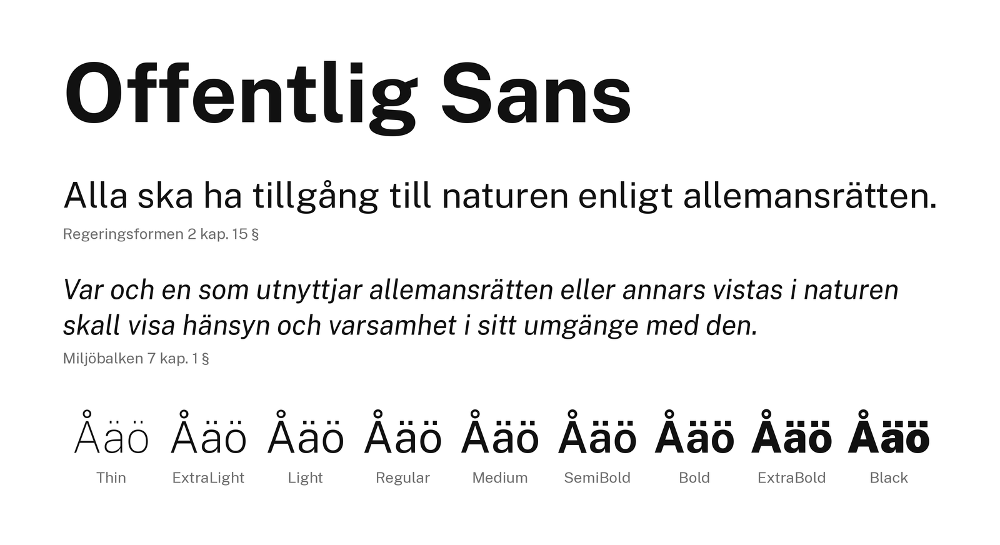

# Offentlig

Offentlig is a planned open-source font superfamily. Offentlig Sans is the first member: a renamed fork of [Public Sans](https://github.com/uswds/public-sans) with correct Swedish letters. Serif and Mono families are planned but not yet started.



## Offentlig Sans

- Nine weights (Thin to Black) in upright and italic, plus variable fonts on the `wght` axis (default 400).
- Stylistic sets: `ss01` selects an alternate `g`, `ss02` an alternate `l`, and `salt` both.
- Formats: OTF, TTF, variable TTF and WOFF2.

## Differences from Public Sans

Offentlig Sans starts from Public Sans `develop` at `e40fcf567` and differs in these ways:

| | Public Sans | Offentlig Sans |
| --- | --- | --- |
| Italic `å` | Renders as `ǻ` (ring with acute accent) | Renders as `å` |
| Subscript digits `₀` – `₉` | Drawn, but not mapped to U+2080 – U+2089 | Mapped, so they work as text |
| Spaced en dash in Thin | Kerning removes the spaces around ` – ` | Spaces kept |
| Capital `Ǔ` (U+01D3) | Missing, though lowercase `ǔ` exists | Added |
| Stylistic sets | `ss01` switches both `g` and `l` | `ss01` switches `g`, `ss02` switches `l`, `salt` both |
| Variable font default | Thin (100) | Regular (400) |

The variable font opens at Regular because Public Sans opens at Thin, so a web page that loads it without setting a weight shows hairline text. Inter, Noto Sans and Atkinson also default to 400.

The first three fixes went to Public Sans as pull requests [#396](https://github.com/uswds/public-sans/pull/396), [#397](https://github.com/uswds/public-sans/pull/397) and [#398](https://github.com/uswds/public-sans/pull/398). The `Ǔ` addition is noted on issue [#258](https://github.com/uswds/public-sans/issues/258).

## Install on macOS

Download the zip from the Releases page. Open the `otf` folder, select all files and open them in Font Book, or copy them to `~/Library/Fonts`. Offentlig Sans installs beside Public Sans without conflict because the family names differ.

## Use on the web

Self-host the WOFF2 files from the `webfonts` folder of the release.

```css
@font-face {
  font-family: "Offentlig Sans";
  src: url("OffentligSans[wght].woff2") format("woff2");
  font-weight: 100 900;
  font-style: normal;
}
@font-face {
  font-family: "Offentlig Sans";
  src: url("OffentligSans-Italic[wght].woff2") format("woff2");
  font-weight: 100 900;
  font-style: italic;
}
```

## Credits and license

- Based on Public Sans by the Public Sans project authors and the [U.S. Web Design System](https://designsystem.digital.gov), commit `e40fcf567` of https://github.com/uswds/public-sans. The U.S. Government's changes are in the public domain; the combined work is used under the OFL.
- Public Sans is based on Libre Franklin by Pablo Impallari and Rodrigo Fuenzalida, a reinterpretation of Morris Fuller Benton's 1912 typeface.
- Offentlig Sans by Ruben Luthman.

Licensed under the SIL Open Font License 1.1, see [LICENSE](LICENSE). The font has no Reserved Font Name, so a web font made by subsetting Offentlig Sans needs no rename. Authors are listed in [AUTHORS.txt](AUTHORS.txt) and [CONTRIBUTORS.txt](CONTRIBUTORS.txt).
