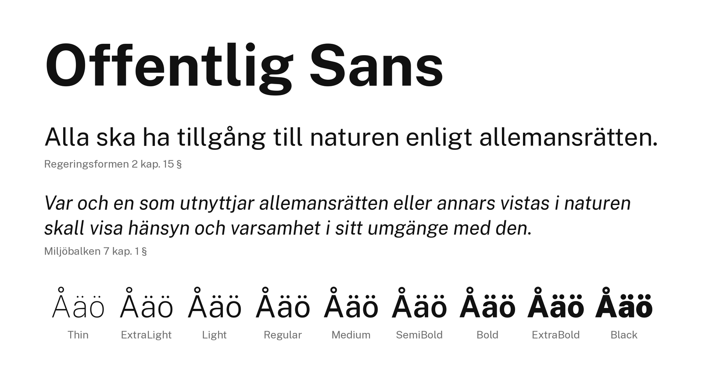

# Offentlig

Offentlig is a planned open-source font superfamily. Offentlig Sans is the first member: a renamed fork of [Public Sans](https://github.com/uswds/public-sans) with correct Swedish letters. Serif and Mono families are planned but not yet started.



<!-- vale HouseStyle.Headings = NO -->
## Offentlig Sans
<!-- vale HouseStyle.Headings = YES -->

- Nine weights (Thin to Black) in upright and italic, plus variable fonts on the `wght` axis (default 400).
- Swedish letters `å ä ö` with a thicker ring, lower diaeresis dots and a drawn capital sharp s `ẞ` (U+1E9E). Uppercasing `ß` still produces `SS`; `ẞ` appears only when typed as U+1E9E.
- Coverage beyond Public Sans: pinyin tone letters, Latin letters of DIN 91379 (not Greek or Cyrillic), eight arrows, the Bitcoin sign `₿`, the prime marks `′ ″ ‴`, the small letters `ʰ ʳ ˢ ᵈ ᵗ ⁿ`, and superscript and subscript `+ − = ( )`, so `x⁽²⁾` and `H₍₂₎O` need no fallback font.
- Optional features, all off by default: `ss01` alternate `g`, `ss02` alternate `l`, `salt` both; `cv01` wider `J`, `cv03` round `G`, `cv04` single-storey `a`, `cv05` `I` with serifs, `cv06` `1` with a base; `zero` slashed `0`; `onum` oldstyle figures (with `tnum`, oldstyle figures of equal width); `ss03` square dots. Each letter form also changes the accented and barred letters built on it (`ĝ ľ ł Ǥ Ɨ`), so a word never mixes two designs.
- Formats: OTF, TTF, variable TTF and WOFF2.

<!-- vale HouseStyle.Headings = NO -->
## Differences from Public Sans
<!-- vale HouseStyle.Headings = YES -->

Offentlig Sans starts from Public Sans `develop` at `e40fcf567`. Sizes are in font units of 2000 per em. The table lists what a reader of text sees.

| | Public Sans | Offentlig Sans |
| --- | --- | --- |
| Italic `å` | Renders as `ǻ` | Renders as `å` |
| Subscript digits `₀` – `₉` | Drawn, not mapped to U+2080 – U+2089 | Mapped |
| Spaced en dash | Kerning removes most of the space in every weight except Black | Spaces kept |
| Spaces U+2007, U+2008, U+2009, U+202F | Missing | Added: figure space (tabular figure width), punctuation space (width of the period), thin space and narrow no-break space; none kerns |
| Capital `Ǔ` (U+01D3) | Missing | Added |
| Pinyin and DIN 91379 | Pinyin tone letters, many Latin Extended letters and several combining marks missing | 20 pinyin tone letters, 108 composite letters, drawn Ƈ ƈ Ɨ ɨ Ǥ ǥ Ʒ ʒ and the combining marks they need; stacked marks land where the precomposed letter puts them |
| Prime marks `′ ″ ‴` and small letters `ʰ ʳ ˢ ᵈ ᵗ ⁿ` | Missing | Added; the letters have the size and stem weight of `ª º` and stand on the baseline of the superior figures, and `sups` sets typed h r s d t n as them after a superior figure, so `1st 2nd 3rd 4th` becomes ¹ˢᵗ ²ⁿᵈ ³ʳᵈ ⁴ᵗʰ |
| Arrows `← ↑ → ↓ ↖ ↗ ↘ ↙` | Missing | Added, drawn by Wayne Shih for Public Sans |
| Em dash | Built-in space of 371 per side at Regular, narrowed by a `calt` rule when spaces are typed around it, so both look the same ([#146](https://github.com/uswds/public-sans/issues/146)); the rule fails when the next space is in another element, such as a link ([#151](https://github.com/uswds/public-sans/issues/151)) | Side bearings of the en dash (124) in every context; no `calt` rule narrows it |
| Hyphen, dashes, `@` and colon next to capitals and figures (`2026-11-18`, `A–Ö`, `@HEJ`, `12:30`) | At lowercase height, so they look low | Raised to the capital centre by `calt`; `E-post` and `12-tal` keep the low forms. Apps can turn `calt` off |
| Brackets `( ) [ ] { }`, guillemets `« » ‹ ›`, `¡ ¿` and the slash in all-capital text (`(HEJ)`, `«HEJ»`, `¿QUÉ?`, `A/B`) | At lowercase height (the slash hangs below the baseline), so they look low | Raised to the capital centre (`¡ ¿` to the baseline, the slash fitted between baseline and cap height) by the `case` feature (turn it on for capital text); by default they stay as they were, so a pair never mismatches |
| `A` before `m n r p h b` | Not kerned | Kerned, never tighter than before `o` |
| Accented letters next to their neighbours (`Yö`, `Tè`, `"în`, `(sí)`, `fî`, `ĴÏ`) | Accent touches a capital's arm, a quote, a bracket, an `f` or another accent, worst in Black | Kerned apart: every pair with an accented letter keeps at least 30 units, or the gap of the same pair without accents where that is smaller, at every weight |
| Plain pairs that touch (`Ax` in Black, `ƒ ₣ ¥ Æ Ł` next to their neighbours) | Some pairs touch or nearly touch in Black and the thinnest weights | At least 30 units of space at every weight |
| `™ ℠ ₿ $ ¢` | Marks sit low, `₿` missing, `$` and `¢` heavy in Bold and Black | Marks at cap height, `₿` added, lighter `$ ¢ ₿` strokes (about 0.56 of the `H` stem at Bold, 0.50 at Black) |
| Ring and diaeresis | Thin ring at Black, close dot spacing in the italic, dots high above the letter | Thicker ring (Black stroke 164, hole 200), upright dot spacing in the italic, dots lower at Thin (54) and Regular (34) |
| `ẞ` and Black `5` | No drawn `ẞ`; Black `5` has a notch at the join | `ẞ` drawn in every weight; clean `5` |
| Oldstyle figures (`onum`) | Components of the lining figures, so nothing changes | Ten drawn oldstyle figures, also on the tabular width with `tnum` |
| Alternates `cv01` `cv03` `cv04` `cv05` `cv06` `zero` `ss03` | None | Optional forms, with matching accented letters and figure variants |
| `%` `‰` `~` `≈` | Thin slash, thin wave in Black | Thicker slash in Regular and Black, stronger Black wave |
| Tilde, macron and hook above a breve | Black tilde and macron heavy, tilde close to the macron, hook above a breve taller than above a circumflex | Black strokes of 200, a wider tilde wave, a lower hook above a breve |
| Italic superior figures | Left of the slant by about 29 units | On the slant, as the subscripts are |
| `+ − = ( )` as superscript and subscript | Missing | Added |
| Accents on italic letters | Off their letter in some weights, up to 169 units (`ž ź š ś Ȓ Â` and 32 more) | On the letter's anchor |
| Caron on `ď ľ ť Ľ` | Curved, runs into a following `b h l` in Black | Straight wedge; `ď ľ` wider so it clears the next letter |
| Marks typed below `J W f g w x y Q` | No anchor below, so a typed dot or macron stays beside the letter | Anchored under the letter and clear of the descender |
| `ȓ` | Breve not where typed `r` + U+0311 puts it | Breve on the anchor of `r`, as in `ȃ ȇ ȏ` |
| Italic `ờ ừ` and the other o-horn and u-horn letters with a stacked mark | A further typed mark lands beside the accent | `top` anchor on the accent, on the slant |
| `Ω` (U+03A9) | Not mapped; only U+2126 is | Both code points use the same glyph |
| `₩ ₦` | Heavy bars close to each other, small counters | Lighter bars set apart, so no counter is a pinhole |
| Diaeresis pairs `ïï ïĩ ïī īï` and thin doubled daggers `†† †‡ ‡† ‡‡` | Marks run into each other in the italic; the daggers meet in Thin | Kerned to at least 30 units at every weight |
| Stylistic sets | `ss01` switches `g` and `l` | `ss01` switches `g`, `ss02` switches `l`, `salt` both |
| Variable font default | Thin (100) | Regular (400) |

The variable font opens at Regular because Public Sans opens at Thin, so a web page that loads it without setting a weight shows hairline text. Inter, Noto Sans and Atkinson also default to 400.

The first three fixes went to Public Sans as pull requests [#396](https://github.com/uswds/public-sans/pull/396), [#397](https://github.com/uswds/public-sans/pull/397) and [#398](https://github.com/uswds/public-sans/pull/398). The `Ǔ` addition is noted on issue [#258](https://github.com/uswds/public-sans/issues/258).

## Install on macOS

Download the zip from the Releases page. Open the `otf` folder, select all files and open them in Font Book, or copy them to `~/Library/Fonts`. Offentlig Sans installs beside Public Sans without conflict because the family names differ.

## Use on the web

Self-host the WOFF2 files from the `webfonts` folder of the release.

```css
@font-face {
  font-family: "Offentlig Sans";
  src: url("OffentligSans[wght].woff2") format("woff2");
  font-weight: 100 900;
  font-style: normal;
}
@font-face {
  font-family: "Offentlig Sans";
  src: url("OffentligSans-Italic[wght].woff2") format("woff2");
  font-weight: 100 900;
  font-style: italic;
}
```

## Credits and license

- Based on Public Sans by the Public Sans project authors and the [U.S. Web Design System](https://designsystem.digital.gov), commit `e40fcf567` of https://github.com/uswds/public-sans. The U.S. Government's changes are in the public domain; the combined work is used under the OFL.
- Public Sans is based on Libre Franklin by Pablo Impallari and Rodrigo Fuenzalida, a reinterpretation of Morris Fuller Benton's 1912 typeface.
- The cleaner Black `5` follows pull request [#194](https://github.com/uswds/public-sans/pull/194) by Cristiano Sobral, and the arrows are drawn by Wayne Shih for Public Sans.
- Offentlig Sans by Ruben Luthman.

Licensed under the SIL Open Font License 1.1, see [LICENSE](LICENSE). The font has no Reserved Font Name, so a web font made by subsetting Offentlig Sans needs no rename. Authors are listed in [AUTHORS.txt](AUTHORS.txt) and [CONTRIBUTORS.txt](CONTRIBUTORS.txt).
